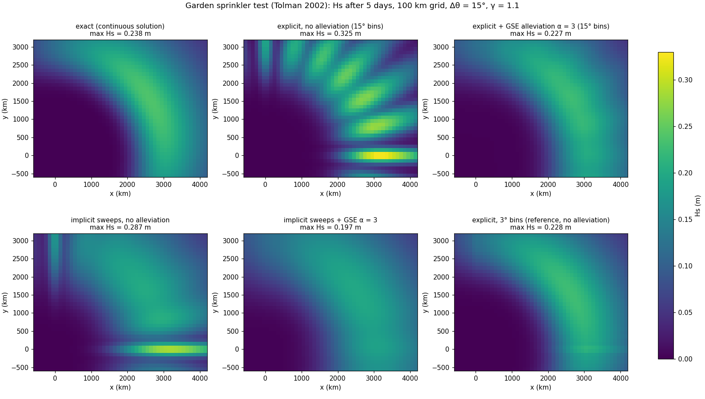

# Garden sprinkler effect (GSE) alleviation



Discretising the spectrum in direction and frequency makes a smooth swell field split into discrete "rays" that separate
as they propagate (Booij & Holthuijsen 1987). The cure implemented here is **anisotropic diffusion of every spectral bin
in physical space**, along (s) and across (n) its propagation direction:

    ∂N/∂τ = ∇·(D∇N),   D = Dss s sᵀ + Dnn n nᵀ
    Dss = αs² (Δcg)² Ts / 3,  Δcg = (γ − 1/γ) cg / 2          Dnn = αn² (cg Δθ)² Ts / 3

* Coefficients: Tolman (2002, WAVEWATCH III spatial averaging); diffusion form and its equivalence to the averaging
  scheme to third order: Popinet, Gorman, Rickard & Tolman (2010, Ocean Modelling 34, 36–49), the Gerris wave model paper.
  (I took "Holman" to mean Booij & Holthuijsen (1987); the original diffusion idea.)
* The diffusion form is the one that generalises to quadtree grids (conservative face fluxes), unlike the averaging stencil.
* Conservative finite-volume discretisation with the full tensor (cross terms), no flux through wet/dry faces,
  explicit sub-stepping chosen from the diffusive stability limit, operator-split after transport and sources.
  Tiny negative undershoots from the cross terms are clipped (this is the only non-conservative step).

## Use
```julia
set_gse!(model; alpha_s = 3.0, alpha_n = 3.0)      # on: explicit run!, implicit run_implicit! / step_implicit!, AND solve_stationary!
set_gse!(model, nothing)                           # off (default)
```
`GSEParams(alpha_s, alpha_n, cfl = 1.0, tau = 0.0, maxsub = 400)`:
* **α**: Popinet et al. report their diffusion form needs α twice WW3's averaging scheme; WW3's customary 1.5 ↔ **3.0 here**.
* **Ts** is the *propagation time step of the frequency component*. WW3 and Gerris advance each frequency with its own step
  (≈ Δx/cg), so the filter displaces the action by a fixed fraction of Δx. With one global solver step that set by the
  fastest waves, the slow components are filtered 4–9× too weakly (my first version: RMS error 0.035 m instead of
  0.009 m below). Default `cfl = 1.0` therefore sets `Ts = cfl·min(Δx,Δy)/cg` per face (Gerris choice): smoothing is then
  independent of the solver step. `tau > 0` imposes a fixed time scale; `cfl = 0, tau = 0` uses the step length (WW3 with
  a single step; dt-dependent).

## Tolman's garden sprinkler test (`gse_tolman_test.jl`)
Gaussian swell blob (Hs₀ = 2.5 m, σ = 150 km, cos² about 30°, 0.1 ± 0.02 Hz), deep water, no sources, Δθ = 15°, γ = 1.1,
Δx = 100 km, 5 days. Errors are against the closed-form continuous solution (exact max Hs = 0.238 m).

| Case | RMS error | max error | max Hs |
|---|---|---|---|
| explicit, no alleviation | 0.051 m | 0.155 m | 0.325 m |
| explicit, α = 3 (default `cfl = 1`) | **0.009 m** | 0.028 m | 0.227 m |
| explicit, α = 4 | 0.012 m | 0.040 m | 0.223 m |
| explicit, α = 3, Ts = global step | 0.035 m | 0.103 m | 0.279 m |
| explicit, 3° bins, no alleviation (reference) | 0.009 m | 0.031 m | 0.228 m |
| implicit sweeps, no alleviation | 0.040 m | 0.124 m | 0.287 m |
| implicit sweeps, α = 1 / 1.5 / 2 / 3 | 0.032 / 0.028 / 0.026 / 0.025 m | 0.102 / 0.088 / 0.079 / 0.077 m | 0.245 / 0.220 / 0.203 / 0.197 m |
| implicit sweeps, 5× step, none / α = 1.5 / α = 3 | 0.043 / 0.033 / 0.031 m | 0.139 / 0.100 / 0.093 m | 0.274 / 0.211 / 0.190 m |

* **Explicit second-order solver**: α = 3 gives the accuracy of 5× finer directional resolution (23 s vs 65 s here) and
  removes the streaks completely (figure, top right). α = 4 already over-smooths slightly: α ≈ 3 is close to optimal.
* **Implicit four-sweep solver**: removes the streaks but cannot reach the explicit accuracy. Its first-order upwinding
  already carries large numerical diffusion, so extra GSE strength mostly trades streaks for damping (peak 0.197 m vs
  0.238 m exact at α = 3). Use a smaller α (≈ 1–1.5) with it, or the explicit scheme where sharp swell fronts matter.
* Tolman (2002) himself describes these techniques as largely cosmetic: they hide the symptom, finer Δθ/γ (Booij &
  Holthuijsen's criterion, roughly Δθ < Δx/L for a source of size L) removes the cause.

## Verified (`test_gse.jl`, 16 checks; Julia 1.13.3)
* Covariance growth of a diffusing Gaussian in an oblique bin equals 2·D·t for xx, yy and the cross term xy
  (1138.9 / 3141.2 / −1734.1 m²/s, identical to the analytic D to the printed precision); total action conserved to 1e-10.
* Off by default; `set_gse!(m, nothing)` restores the original behaviour exactly.
* `cfl` mode is step-independent: one 2000 s step vs four 500 s steps differ by 6e-5 of the peak.
* With transport: total action drifts by +1.2e-4 (explicit) and +1.3e-4 (implicit) over a day (the clipping of
  undershoots), minimum N ≥ 0.
* Stationary solver with GSE: error vs exact reduced from 0.069 m to 0.026 m; agrees with the long time-dependent run (0.004 m rms).
* Results are bit-identical for 1 and 4 threads with GSE on, for the explicit, implicit and stationary solvers.
* The earlier suites still pass after the change: `test_wave.jl` 20/20, `test_sweep.jl` 19/19.

## Stationary mode (`solve_stationary!`)
There is no time step in stationary mode, so the filter cannot be an operator-split step; it enters the steady equation
as a diffusion term `∇·(D∇N)` on the right-hand side. This is possible because the default filter time scale
`Ts = cfl·Δx/cg` does not depend on a time step (a model set with `cfl = 0, tau = 0` falls back to `cfl = 1` with a note). In the
four-sweep iteration the along-axis parts (Dxx, Dyy) are implicit (diagonal + known neighbours; no flux through dry faces or
zero-gradient boundaries) and the cross term (Dxy) is explicit, computed from the current iterate before each sweep in a
separate threaded pass (so the wavefront threading stays race-free and bit-identical across thread counts).
(An earlier version of this code only hooked the filter into the time-stepping routines, so `solve_stationary!` silently ignored `set_gse!`.)

Test (`gse_stationary_test.jl`, figure `gse_stationary_comparison.png`): a swell with broad directional spreading hits a dry
barrier with a 40 km gap (a point source), 10° bins, Δx = 10 km. In deep water the exact stationary field is geometric (the
fraction of the incident directional distribution whose ray passes the gap). Without the filter the θ = 0 bin
leaves the gap as a 40 km-wide jet that persists to 700 km; with it the field spreads smoothly like the exact solution.

| Stationary solver | iterations | RMS error | max error |
|---|---|---|---|
| no alleviation | 2 | 0.069 m | 0.271 m |
| α = 1 | 6 | 0.050 m | 0.205 m |
| α = 2 | 10 | 0.034 m | 0.143 m |
| α = 3 | 16 | 0.026 m | 0.149 m |

The steady-diffusion solution agrees with a long non-stationary implicit run using the split-step filter (rms difference
0.004 m; both 0.026 m from exact) and costs 9 s against 28 s here. Costs: more iterations (2 → 16 at α = 3).

## Limitations
* Cosmetic by nature, and it adds physical-space smoothing of the real spectrum (swell fronts are smeared by about
  α·(offsets) ≈ 0.27–0.8 Δx per step-equivalent); it can over-smooth sharp features, notably with the implicit solver.
* α = 3 is calibrated to Popinet et al.'s agreement with WW3 on this test; I have not tuned it for other cases
  (currents, shoaling, coasts). Near depth changes the face-based D uses the local cg, but this is untested.
* Cost: one explicit diffusion pass per solver step (more sub-steps for large implicit steps).
* Not yet implemented on the GPU/quadtree: the diffusion form maps onto BG_Flood's flux/halo machinery (face coefficients,
  fine-to-coarse flux fill) but that needs the halo code.

## Performance of the GSE filter (v2)

The filter was the dominant extra cost, so it was rewritten:

* **Cached coefficients.** Face diffusivities and the cross-term weights are built once (`gse_prepare!`) and reused until
  `update_environment!` is called (same idea as the cached refraction speeds).
* **Fused sub-steps.** Each explicit sub-step is two passes per direction (fluxes, then in-place update) with `@simd`
  inner loops over the contiguous spectral index; no temporary arrays.
  Same results as the old code to round-off (2e-16) for identical sub-step counts, ~4.7× faster per sub-step.
* **Douglas–Gunn ADI for large steps.** The explicit sub-step count grows as `dt·D/Δx²`. When it exceeds `adi_above`
  (default 2) the filter switches to an unconditionally stable ADI step (axes implicit, cross term explicit),
  whose cost is independent of dt (`gse_step!` returns -1 in that case).
* New `set_gse!` keywords: `safety` (explicit stability margin, default 2.5), `adi_above` (default 2; use a huge value to force
  explicit sub-stepping, 0 to always use ADI), `maxsub`.

Measured (Tolman swell case, 1 thread; sandbox is single-core, threaded speed-up not measured):

| run | old filter | new filter | no GSE |
|---|---|---|---|
| explicit solver, α = 3 (rms 0.009 m) | 13.3 s | 8.3 s | 6.5 s |
| implicit 1× CFL, α = 1.5 | 13.7 s | 8.6 s | – |
| implicit 5× CFL, α = 1.5 (rms 0.033 m) | 2.8 s | 1.7 s | – |
| implicit 20× CFL, α = 1.5 (rms 0.046 m) | 1.0 s | 0.6 s | 0.3 s (rms 0.052 m) |

So the filter now costs ~25 % on top of the explicit solver (it was ~100 %).

**Caveats.** The ADI path is backward-Euler/split: it differs from fine explicit sub-stepping by ~5 % of the peak at ~5× the
explicit limit and more for sharp features at much larger steps (the tests check ≤ 8 % for a 2000 s step).
It is also slightly non-conservative (≈1e-9 relative per step in the blob test, from clipping small negatives; larger for
extreme steps with sharp edges). Use `adi_above = typemax(Int)÷2` when accuracy matters more than speed.
Results are bit-identical for 1 vs 4 threads on both paths.
